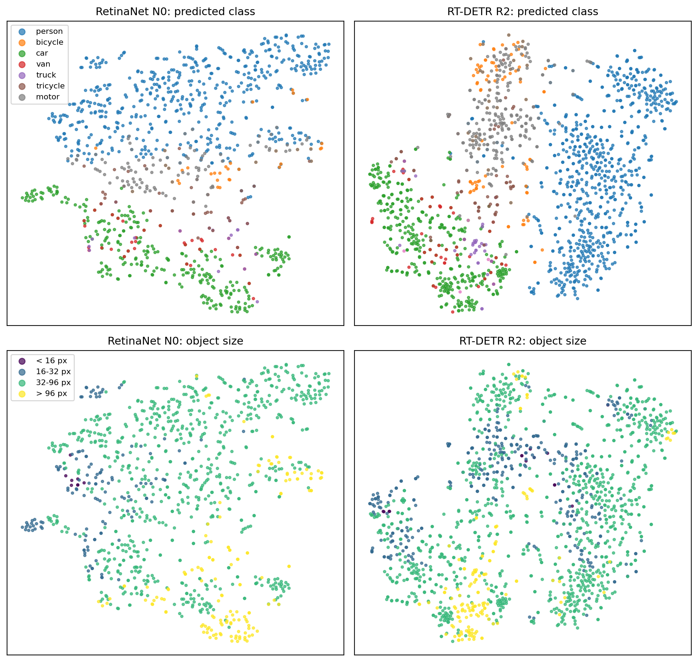

## Introduction

The video analyzing of the VisDrone data set is quite a difficult task of its own with horrible scale variation, tiny targets severe occlusions, view point changes and breaking the line of sights making the job of the models very interesting to say the least. Our task and motivation is to find the such a computer vision model that will detect the subjects in such harsh conditions. We compare four detector families: two-stage (Faster R-CNN), one-stage anchor-based (RetinaNet), anchor-free (YOLOv8) and query-based (RT-DETR). We whave also done the bonus tasks of recovering temporal context and visualizing the results using W&B.

## Data Preparation & Training Protocol

We use the same methods of training on each of the models so lets explain them now. The official training clips use every 5th frame with blacked out regions that should be ignored which prevents false-positive penalties. We use clips to avoid data leakage. Neighbouring frames are almost the same - object overlaps its own box with IoU 0.90 one frame later, but 0.59 five frames later. Training on every 5th frame keeps almost the same information at 5× lower cost. All models are scored by the same evaluator over the 8 classes with up to 500 detections per frame. Ignored regions are treated as crowd so detections there are not penalized. All models are trained and evaluated at 1280 px: at 640 px 53.6% of objects become smaller than 16 px, at 1280 px only 9.7%.

## YOLOv8

Now to the first model:
Yolov8 is an anchor free / different boxes for different objects, decoupled heads using model that was tested on three main variants:
* **E0**: standard resolution of 640x640
* **E1**: scaled resolution of 1280x1280
* **E2**: Uses high resolution and adds a head that has a stride of 4 and it having 320x320 cells per image

| | mAP | AP50 | AP75 | AP_tiny | AP_small | AP_medium | AP_large | AR500 | ms_per_img |
| :--- | :---: | :---: | :---: | :---: | :---: | :---: | :---: | :---: | :---: |
| **E0** | 12.4 | 25.2 | 10.9 | 1.0 | 4.5 | 11.5 | 25.1 | 23.8 | 45.1 |
| **E1** | 19.8 | 39.3 | 17.6 | 1.6 | 12.7 | 18.9 | 31.6 | 32.3 | 55.2 |
| **E2** | 19.0 | 37.9 | 16.6 | 1.0 | 10.3 | 18.2 | 31.3 | 30.8 | 65.6 |

Resolution was the biggest imporvment: 640 - 1280 px gave +7.4 mAP and raised AP_small from 4.5 to 12.7. The P2 head (E2) did not help (19.0 mAP) and was slower: only 219 of 437 weight tensors could be loaded from COCO, so the new layers started from scratch and 25 epochs were not enough. E1 was submitted with public LB 0.2162

## Faster R-CNN

Faster R-CNN works in two stages: RPN that slides over feature maps and filters top K region proposals and Faster R-CNN rol head that extracts a feature vector that is classifying on 8 VisDrone categories. We trained on three categories
* **F0**: Default Torch vision anchors 32-512 px
* **F1**: Shifted them to be 16-256 px
* **F2**: Implements Giou which regulates loss for tiny object to have a stricter false penalty rule. (in short for tiny object loss of 2 px is massive but for large is not so)

| run \| test-time setting | mAP | AP50 | AP75 | AP_tiny | AP_small | AP_medium | AP_large | AR500 | ms_per_img |
| :--- | :---: | :---: | :---: | :---: | :---: | :---: | :---: | :---: | :---: |
| **F0 \| default (100 det, score 0.05, 1000 prop.)** | 17.8 | 36.0 | 15.6 | 1.7 | 9.1 | 15.9 | 32.8 | 25.9 | 134.4 |
| **F0 \| 500 det, score 0.001, 1000 prop.** | 19.4 | 40.3 | 16.5 | 1.8 | 9.6 | 17.5 | 36.2 | 36.9 | 133.8 |
| **F0 \| 500 det, score 0.001, 3000 prop.** | 19.8 | 41.8 | 16.5 | 1.9 | 9.7 | 18.0 | 36.1 | 38.4 | 150.8 |
| **F1 \| 500 det, score 0.001, 1000 prop.** | 19.5 | 41.3 | 16.2 | 1.6 | 9.1 | 17.6 | 36.2 | 38.3 | 121.1 |
| **F1 \| 500 det, score 0.001, 3000 prop.** | 19.6 | 41.4 | 16.1 | 1.6 | 9.1 | 17.6 | 35.9 | 37.9 | 133.6 |
| **F2 \| 500 det, score 0.001, 1000 prop.** | 19.3 | 41.3 | 15.7 | 1.7 | 9.3 | 17.9 | 35.3 | 35.5 | 135.4 |
| **F2 \| 500 det, score 0.001, 3000 prop.** | 19.3 | 41.4 | 15.7 | 1.7 | 9.3 | 18.0 | 35.1 | 35.5 | 151.2 |

Results:
The biggest gain came from inference settings - keeping 500 detections per image with score threshold 0.001 raised F0 from 17.8 to 19.4 mAP because the default 100 detections cut recall in dense frames. F1 (smaller anchors, 19.6) and F2 (+GIoU, 19.3) did not improve on F0. GIoU helped bicycle (+1.8 AP) but hurt truck (−2.3 AP).

1000 proposals already cover 84.8% of objects, but only 15.8% of objects below 16 px are found after the second stage, so small objects are lost. Typical failures are distant cars in downscaled 4K frames, vans detected as cars, motorcycles confused with persons. F0 was submitted with public LB 0.2417.

## RetinaNet

RetinaNet Generated anchor on all feature maps in one go without generating proposals. To lessen the imbalance of positive and background anchors it uses focal loss where well classified objects contribute less and training focuses on the hard ones.
* **N0**: Again default Torchvision anchors 32-512 px
* **N1**: Decreses the anchor bases to 8-128 px
* **N2**: Giou strikes again to make the life better (?)

| run \| test-time setting | mAP | AP50 | AP75 | AP_tiny | AP_small | AP_medium | AP_large | AR500 | ms_per_img |
| :--- | :---: | :---: | :---: | :---: | :---: | :---: | :---: | :---: | :---: |
| **N0 \| default (300 det, score 0.05)** | 16.7 | 32.2 | 15.4 | 0.3 | 5.6 | 15.1 | 33.6 | 34.1 | 135.1 |
| **N0 \| 500 det, score 0.001** | 16.7 | 32.3 | 15.4 | 0.3 | 5.6 | 15.1 | 33.7 | 34.6 | 133.0 |
| **N1 \| 500 det, score 0.001** | 10.1 | 26.7 | 6.0 | 0.5 | 3.9 | 9.5 | 19.0 | 30.3 | 139.8 |
| **N2 \| 500 det, score 0.001** | 10.6 | 27.8 | 6.1 | 1.1 | 4.5 | 10.0 | 19.7 | 30.9 | 128.7 |

Results: N0 is best while N1 gave far worse results. An 8 px anchor on a stride-8 grid rarely reaches IoU ≥ 0.5 with an object, so positive anchors per frame dropped from 639 to 96. The largest anchor also shrank to about 200 px, so large objects lost matching anchors (from AP_large 33.7 to 19.0). GIoU (N2) recovered only +0.5. N1 and N2 were still improving at epoch 8, so their gap to N0 is likely overstated.

## RT-DETR-L

RT-DETR-L replaced anchor and other sea based references by a fully based tranformer. It processes features, fuses them via hybrid intra-scale encoder and then decodes through 6 layered transformer decoder after which it assigns exactly one prediction per ground truth.
* **R0**: IT pretty much full run similar to Yolo E1 1280 px 25 epochs
* **R1**: Increases the queries from 300 to 500
* **R2**: Just ignores denoising queries

| | mAP | AP50 | AP75 | AP_tiny | AP_small | AP_medium | AP_large | AR500 | queries | denoising | ms_per_img |
| :--- | :---: | :---: | :---: | :---: | :---: | :---: | :---: | :---: | :---: | :---: | :---: |
| **R0** | 17.9 | 41.5 | 12.9 | 0.1 | 8.4 | 16.7 | 30.1 | 32.5 | 300.0 | 100.0 | 120.5 |
| **R2** | 23.4 | 46.8 | 20.4 | 1.2 | 10.8 | 22.4 | 39.1 | 39.3 | 300.0 | 0.0 | 115.7 |
| **R1** | 22.7 | 46.9 | 19.2 | 0.5 | 12.2 | 21.1 | 37.6 | 38.7 | 500.0 | 100.0 | 117.3 |

R2 (no denoising) is best with 23.4 mAP, with much better localisation than R0 (AP75 20.4 vs 12.9). 500 queries (R1) give the best AP_small 12.2. All runs levelled off after 12–15 epochs. Our hypothesis for why disabling denoising helped is because with up to 180 objects per frame, 100 denoising groups add very many extra queries, and their loss dominates training. RT-DETR finds more objects in dense frames than YOLO (recall 76.7% vs 67.0% in frames with more than 80 objects), but is worse on small objects (AP_small 10.8 vs 12.7). R2 was submitted with public LB 0.2583.

## Model Comparison

| model | mAP | AP_small | AP_large | ms/img | public LB |
| :--- | :---: | :---: | :---: | :---: | :---: |
| **RT-DETR R2** | 23.4 | 10.8 | 39.1 | 116 | 0.2583 |
| **Faster R-CNN F0** | 19.8 | 9.7 | 36.1 | 151 | 0.2417 |
| **YOLOv8s E1** | 19.8 | 12.7 | 31.6 | 55 | 0.2162 |
| **RetinaNet N0** | 16.7 | 5.6 | 33.7 | 133 | 0.2356 |

## Bonus 1

We used the Hungarian Iou to track object through consecutive frames. Those object that appear on the multiple frames gain wight and objects that drop decrease it. This improved RetinaNet by 0.003 and RT-DETR by 0.002 (not much but honest days work)

| Submission | Public Score |
| :--- | :---: |
| `submission_rtdetr_R2_temporal.csv` | 0.2605031449 |
| `submission_retina_N0_temporal.csv` | 0.2388396969 |
| `submission_rtdetr_R2.csv` | 0.2582578623 |
| `submission_retina_N0.csv` | 0.2355788629 |

## Bonus 2

W&B Project Link: https://forge.coreweave.com/wandb/antondep007-ukranian-catholic-university/visdrone-object-detection?nw=nwuserantondep007



The main problem with this bonus task was to log into the W&B (why is this so confusing?). Now seriously the people in t-SNE for RetinaNet N0 and RT-DETR R2 forms a cluster, but vehicle and bicycle group have serious problem differentiating. The size plots reveal that features group by semantics and not the object scale. RT-DETR had the best separation of the models we tested which is pretty reasonable.

## Final Pipeline

Part A changes only the inference of RT-DETR R2: every frame is also predicted flipped and as $2 \times 2$ overlapping tiles, and the views are merged with WBF. Part B changes only the models: RT-DETR, Faster R-CNN and YOLO are fused with WBF

| step | val mAP | AP_small | public LB |
| :--- | :---: | :---: | :---: |
| **RT-DETR R2 alone** | 23.4 | 10.8 | 0.2583 |
| **A: flip + tiles** | 25.1 | 13.4 | — |
| **B: ensemble** | 25.7 | 13.4 | 0.278 |
| **A + B** | 26.7 | 15.3 | 0.277 |

YOLO is the weakest model alone but adds most to the ensemble (+1.4 mAP), because it is the best on small objects. RetinaNet was not included - it has weakest results. Both final submissions were selected on validation: A + B as the best pipeline, and B as second choice. On the leaderboard B scored slightly higher.

## Prerequisites & How to Run

* **Hardware:** NVIDIA GPU with $\ge 16$ GB VRAM
* **OS / Runtime:** Google Colab
* **Dependencies:**
  ```bash
  pip install -q torch torchvision ultralytics pycocotools pandas scipy wandb opencv ensemble-boxes
  ```

Run the notebooks with the secret api code from kaggle for the data inserted into the colab secrets of each notebook. At first run Smoke True to test and then use Smoke False to run full train. Notebooks 01 (EDA), 06 (final pipeline) and 07 (bonus) need minutes to about an hour; the training notebooks 02–05 need a GPU and several hours per experiment (RT-DETR alone total of more than 20 hours). Notebooks should be run in order. All runs use seed 42.

## AI Declaration

We have used ai for the code in the notebooks to make the task faster. There were mistakes that ai made that we needed to fix by ourselves like the secret key issues and the coefficients in retina. Otherwise 99% of the text in the report and notebooks is written by us.
